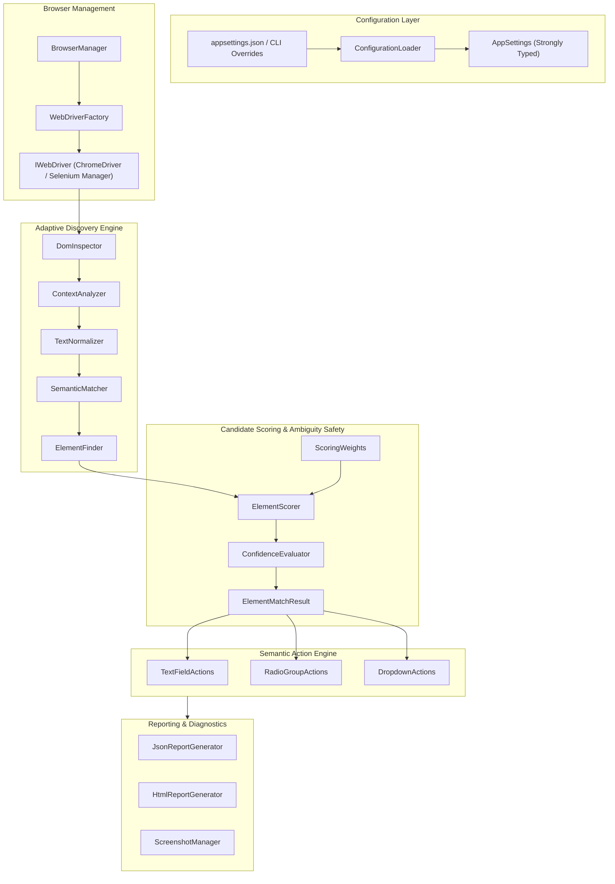

# Adaptive Selenium Automation Framework (.NET 8 & C#)

[]()
[-brightgreen.svg)]()
[-brightgreen.svg)]()
[]()
[]()
[]()

> **Senior SDET & Automation Specialist Internship Assessment — Task 1**  
> A resilient, adaptive web form automation framework that dynamically identifies and tests form fields without relying on brittle, hardcoded IDs, static CSS classes, or positional XPaths.

---

## 1. Problem Statement

Conventional Selenium test suites are notorious for their fragility:
- **Dynamic Front-End Frameworks (React, Blazor, Angular):** Frequently generate dynamic or randomized element IDs (e.g. `id=":r1:"`, `id="input-184920"`).
- **Styling Redesigns:** Migrating CSS frameworks (e.g., Bootstrap to Tailwind) alters class names, breaking CSS locators.
- **Layout & Order Changes:** Adding promotional banners, rearranging form controls, or reorganizing divs invalidates rigid positional XPaths (`//form/div[2]/input`).

When tests break due to non-functional markup changes, teams suffer from high maintenance overhead, flaky test suites, and eroded confidence in automated pipelines.

---

## 2. Project Objective & Core Capabilities

This project implements an **Adaptive Semantic Identification Engine** in C# and Selenium WebDriver that automatically identifies and interacts with three critical fields on the target form:
1. **First Name** — Text input control.
2. **Gender** — Logical radio button group.
3. **State** — Dropdown/select element.

### Key Resilience Capabilities:
- **Attribute Independence:** Operates successfully when IDs, names, and CSS classes are scrambled or removed.
- **Position Independence:** Operates regardless of field placement or reordering.
- **Structural Independence:** Resilient to nested wrapper divs, custom containers, and wrapping `<label>` tags.
- **Disambiguation Intelligence:** Uses negative semantic scoring to distinguish similar fields (e.g., selecting *First Name* while rejecting *Last Name*, *Middle Name*, or *Company Name*).
- **Ambiguity Safeguard:** Rejects ambiguous, competing candidates with close scores instead of making arbitrary, unsafe guesses.
- **Complete Traceability:** Generates structured JSON reports, rich HTML dashboards, and automated failure screenshots.

---

## 3. Technology Stack

| Technology | Role |
|---|---|
| **C# 12 / .NET 8** | Primary programming language and modern managed runtime |
| **Selenium WebDriver 4.26** | Browser automation engine with modern W3C compliance |
| **ChromeDriver / Selenium Manager** | Automated, zero-config browser driver management |
| **NUnit 4.2 & NUnit3TestAdapter** | Automated unit and integration test framework |
| **Microsoft.Extensions.Configuration** | Hierarchical configuration management (`appsettings.json`, env vars, CLI) |
| **Microsoft.Extensions.Logging** | Structured, colorized console and diagnostic logging |
| **System.Text.Json** | High-performance JSON report generation |
| **Git & GitHub** | Source code version control and submission |

---

## 4. Architecture Overview



---

## 5. Project Folder Structure

```
adaptive-selenium-automation/
│
├── src/
│   └── AdaptiveAutomation/
│       │
│       ├── Configuration/
│       │   ├── AppSettings.cs              # Strongly typed configuration models
│       │   └── ConfigurationLoader.cs      # Multi-source config loader (JSON, CLI, ENV)
│       │
│       ├── Browser/
│       │   ├── WebDriverFactory.cs         # Chrome/Edge options and driver lifecycle
│       │   └── BrowserManager.cs           # Driver session manager and screenshot hooks
│       │
│       ├── Discovery/
│       │   ├── DomInspector.cs             # Runtime DOM candidate query engine
│       │   ├── ContextAnalyzer.cs          # Semantic signal extractor (labels, ARIA, headings)
│       │   ├── SemanticMatcher.cs          # Natural language token and synonym matcher
│       │   └── ElementFinder.cs            # Orchestrator combining discovery, scoring & evaluation
│       │
│       ├── Scoring/
│       │   ├── ElementScorer.cs            # Deterministic weighted scoring engine
│       │   ├── ScoringWeights.cs           # Configurable heuristic weights
│       │   └── ConfidenceEvaluator.cs      # Threshold evaluation and ambiguity detection
│       │
│       ├── Models/
│       │   ├── ElementCandidate.cs         # Inspected DOM candidate profile
│       │   ├── ElementMatchResult.cs       # Match result, audit breakdown, confidence
│       │   ├── FieldDefinition.cs          # Semantic field definitions and synonyms
│       │   ├── TestResult.cs               # Test execution telemetry
│       │   └── Enums.cs                    # FieldType, ConfidenceLevel, TestStatus
│       │
│       ├── Actions/
│       │   ├── TextFieldActions.cs         # Robust text input interaction & value verification
│       │   ├── RadioGroupActions.cs        # Radio group discovery, selection & state assertion
│       │   └── DropdownActions.cs          # SelectElement interaction & option verification
│       │
│       ├── Tests/
│       │   ├── BaseTest.cs                 # NUnit setup, teardown, screenshot capture
│       │   ├── FirstNameTests.cs           # First Name field verification
│       │   ├── GenderTests.cs              # Gender radio group verification
│       │   ├── StateTests.cs               # State dropdown verification
│       │   └── AdaptiveRegressionTests.cs   # Comprehensive mutation test suite
│       │
│       ├── Reporting/
│       │   ├── JsonReportGenerator.cs      # Machine-readable JSON report generator
│       │   ├── HtmlReportGenerator.cs      # Visual executive HTML dashboard
│       │   └── ScreenshotManager.cs        # Failure screenshot capture
│       │
│       ├── Utilities/
│       │   ├── TextNormalizer.cs           # Tokenizer, case-folding, whitespace normalizer
│       │   └── WaitHelper.cs               # Explicit wait and retry policy helper
│       │
│       ├── Program.cs                      # Standalone CLI entry point
│       ├── appsettings.json                # Runtime configuration
│       └── AdaptiveAutomation.csproj       # Project build specification
│
├── fixtures/                               # Controlled HTML mutation test fixtures
│   ├── baseline.html                       # Structural model of target form
│   ├── changed-attributes.html             # Randomized IDs, names, and CSS classes
│   ├── reordered-fields.html               # State first, Gender second, First Name last
│   ├── changed-structure.html              # Nested divs, wrapping labels, fieldset/legend
│   ├── similar-fields.html                 # Multiple similar inputs, groups, and selects
│   ├── ambiguous-fields.html               # Competing identical fields (ambiguity test)
│   └── missing-fields.html                 # Omitted fields (failure handling test)
│
├── docs/                                   # In-depth architectural & assessment documentation
│   ├── TARGET_PAGE_ANALYSIS.md             # Detailed DOM inspection of CloudQA site
│   ├── ARCHITECTURE.md                     # Architecture specification & component design
│   ├── ADAPTIVE_IDENTIFICATION.md          # Scoring algorithm & matching heuristics
│   ├── TEST_RESULTS.md                     # Execution logs, scores, and benchmark tables
│   ├── APPROACH_AND_LIMITATIONS.md         # Design decisions, edge cases, and future roadmap
│   └── DEMO_SCRIPT.md                      # 5-minute technical interview demonstration script
│
├── artifacts/                              # Generated execution evidence
│   ├── reports/
│   │   ├── latest-report.json              # Machine-readable JSON telemetry
│   │   └── latest-report.html              # Executive HTML dashboard
│   ├── screenshots/failures/               # Automatic failure screenshots
│   └── logs/                               # Execution logs
│
├── .gitignore                              # Git exclusion rules
├── .editorconfig                           # Code formatting rules
├── README.md                               # Framework documentation
└── AdaptiveAutomation.sln                  # Visual Studio solution file
```

---

## 6. Adaptive Identification Algorithm & Scoring Matrix

Each candidate element is scored against field definitions using calibrated weights:

$$\text{Score}(c) = \min\left(100, \max\left(0, \sum W_i \cdot M_i(c) - \sum P_j \cdot C_j(c)\right)\right)$$

| Signal | Weight | Description |
|---|---|---|
| **Exact Associated Label Match** | `40` | Directly associated `<label for="...">` or `<label>` wrapping input |
| **Exact Accessible Name Match** | `35` | `aria-label`, `aria-labelledby`, or `title` match |
| **Contextual Proximity Text** | `25` | Container headings, `<legend>`, or preceding text siblings |
| **Placeholder Match** | `20` | `placeholder` attribute matching semantic synonyms |
| **Technical Type Match** | `15` | Validates element tag and input type (`text`, `radio-group`, `select`) |
| **Container Relevance** | `15` | Enclosing container header corroboration |
| **Attribute Name / ID Match** | `15` | Semantic tokens inside `name` or `id` attributes |
| **Contradictory Keyword Penalty** | `-50` | Conflicting keywords (e.g. `Last`, `Company`, `Middle` when searching `First Name`) |

### Confidence Classification
- **High Confidence (80–100):** Strong multi-signal corroboration. Safe for direct interaction.
- **Medium Confidence (60–79):** Solid semantic evidence. Safe for direct interaction.
- **Low Confidence (< 60):** Insufficient evidence. The engine safely aborts.
- **Ambiguity Gate ($\Delta \le 5$):** If the top two candidates score within 5 points of each other, the engine triggers an **Ambiguity Refusal** to prevent interacting with the wrong field.

---

## 7. Prerequisites & Installation

### Prerequisites:
- Windows 10/11
- Google Chrome browser installed
- Git for Windows
- .NET 8 SDK (local project SDK included in `.dotnet` or system-wide .NET 8)

### Verification:
```powershell
# Verify .NET SDK
.\.dotnet\dotnet.exe --version
# Output: 8.0.427
```

---

## 8. How to Build & Run

### 8.1 Build the Solution
```powershell
.\.dotnet\dotnet.exe build
```

### 8.2 Run Against the Live CloudQA Target Webpage
```powershell
# Run with Headless Mode enabled (recommended for fast CI runs)
.\.dotnet\dotnet.exe run --project src/AdaptiveAutomation/AdaptiveAutomation.csproj -- --url "https://app.cloudqa.io/home/AutomationPracticeForm" --headless true

# Run with Headless Mode disabled (to watch browser interactions)
.\.dotnet\dotnet.exe run --project src/AdaptiveAutomation/AdaptiveAutomation.csproj -- --url "https://app.cloudqa.io/home/AutomationPracticeForm" --headless false
```

### 8.3 Run the Standalone Fixture Runner (All 7 Fixtures)
A dedicated PowerShell script executes the **same compiled binary** (`AdaptiveAutomation.exe`) sequentially across all 7 HTML mutation fixtures via `--url` and independently verifies field-level expected vs actual values:
```powershell
powershell -ExecutionPolicy Bypass -File ".\scripts\run-all-fixtures.ps1"
```

### 8.4 Run the Automated Test Suite (NUnit)
```powershell
# Run all 47 tests (Unit, Mutation, Failure & Value Verification tests)
.\.dotnet\dotnet.exe test --no-build --logger "console;verbosity=normal"

# Run specific test suites
.\.dotnet\dotnet.exe test --filter "FullyQualifiedName~AdaptiveRegressionTests" --no-build
.\.dotnet\dotnet.exe test --filter "FullyQualifiedName~LabelVariationTests" --no-build
.\.dotnet\dotnet.exe test --filter "FullyQualifiedName~InteractionFailureTests" --no-build
.\.dotnet\dotnet.exe test --filter "FullyQualifiedName~SimilarFieldsExpandedTests" --no-build
.\.dotnet\dotnet.exe test --filter "FullyQualifiedName~ValueVerificationTests" --no-build
```

---

## 9. Comprehensive Mutation Testing Scenarios (All 8 Covered)

| Mutation Category | Scenario Simulated | Key Verification | Result |
|---|---|---|---|
| **Mutation 1** | Scrambled IDs (`u_rand_1092`), names (`param_fn_382`), classes (`box-modern`) | Interacts with First Name, Gender, State via semantic text signals | **PASS (1/1)** |
| **Mutation 2** | State placed 1st, Gender 2nd, Last Name 3rd, First Name last | Identifies all fields regardless of DOM order | **PASS (1/1)** |
| **Mutation 3** | Deeply nested divs, wrapped `<label>`, `<fieldset><legend>`, `aria-label="State"` | Discovers wrapped inputs, fieldsets, and ARIA accessible names | **PASS (1/1)** |
| **Mutation 4** | Standard & Expanded competing fields (Middle Name, Company Name, Billing State, etc.) | Negative keyword penalties (-50.0) prevent false positive matches | **PASS (2/2)** |
| **Mutation 5** | Label variations ("Given Name", "Your Gender", "State/Province", "Enter First Name") | Tests all synonyms and verifies safe rejection of unrelated fields | **PASS (7/7)** |
| **Mutation 6** | Two identical First Name fields without distinguishing context | Safely reports **Ambiguous** instead of guessing | **PASS (1/1)** |
| **Mutation 7** | Form contains only Email and Comments (target fields absent) | Fails gracefully with clear diagnostic message | **PASS (1/1)** |
| **Mutation 8** | Interaction failures (Disabled inputs, Hidden elements, Missing options, Stale elements) | Detects inactive state, handles DOM detachment, recovers gracefully | **PASS (8/8)** |
| **Live Form** | Live CloudQA integration test suite | First Name (99.2%), Gender (93.5%), State (94.0%) | **PASS (4/4)** |

---

## 10. Sample Execution Output

```
======================================================================
   Adaptive Selenium Web Form Automation Engine (.NET 8)
======================================================================
11:10:27 info: AdaptiveAutomation[0] Target URL: https://app.cloudqa.io/home/AutomationPracticeForm
11:10:27 info: AdaptiveAutomation[0] Headless Mode: True
11:10:27 info: AdaptiveAutomation[0] Test Data: FirstName='Shiva', Gender='Male', State='India'
11:10:27 info: AdaptiveAutomation[0] Navigating to URL: https://app.cloudqa.io/home/AutomationPracticeForm
Starting ChromeDriver 156.0.8078.80 on port 63773
11:10:35 info: AdaptiveAutomation[0] Locating field 'First Name' of type TextInput...
11:10:42 info: AdaptiveAutomation[0] Match result for 'First Name': Score=99.25, Confidence=High, Ambiguous=False
11:10:42 info: AdaptiveAutomation[0] Entered 'Shiva' into candidate <input id='fname' name='First Name' type='text' label='First Name' placeholder='Name'>
11:10:42 info: AdaptiveAutomation[0] Locating field 'Gender' of type RadioGroup...
11:10:43 info: AdaptiveAutomation[0] Match result for 'Gender': Score=93.5, Confidence=High, Ambiguous=False
11:10:43 info: AdaptiveAutomation[0] Radio option 'Male' selected: SelectedState=True
11:10:43 info: AdaptiveAutomation[0] Locating field 'State' of type Dropdown...
11:10:45 info: AdaptiveAutomation[0] Match result for 'State': Score=94, Confidence=High, Ambiguous=False
11:10:46 info: AdaptiveAutomation[0] Dropdown option selected. Text='India', Value='India'
11:10:47 info: AdaptiveAutomation[0] WebDriver session disposed cleanly.

----------------------------------------------------------------------
                        EXECUTION SUMMARY                             
----------------------------------------------------------------------
[PASS] First Name   | Conf:  99.2% | Expected: Shiva      | Actual: Shiva      (7.59s)
[PASS] Gender       | Conf:  93.5% | Expected: Male       | Actual: Male       (1.20s)
[PASS] State        | Conf:  94.0% | Expected: India      | Actual: India      (2.19s)
----------------------------------------------------------------------
Results: 3/3 Passed.
Reports Generated:
  - JSON: artifacts\reports\latest-report.json
  - HTML: artifacts\reports\latest-report.html
----------------------------------------------------------------------
```

---

## 11. Technical Audit & Forensic Documentation

For complete technical depth and audit defense, the following dedicated investigation reports are provided:
- **[Final Submission Checklist](file:///c:/Users/Madugu%20Shiva%20Kumar/OneDrive/图片/Desktop/adaptive-selenium-automation/docs/FINAL_SUBMISSION_CHECKLIST.md):** Verification of all 15 audit inspection criteria, test runs, and sign-offs.
- **[Final Audit Report](file:///c:/Users/Madugu%20Shiva%20Kumar/OneDrive/图片/Desktop/adaptive-selenium-automation/docs/FINAL_AUDIT_REPORT.md):** Initial audit findings, defect classification, and architectural resolutions.
- **[State vs Country Forensic Investigation](file:///c:/Users/Madugu%20Shiva%20Kumar/OneDrive/图片/Desktop/adaptive-selenium-automation/docs/STATE_FIELD_INVESTIGATION.md):** Forensic DOM proof that CloudQA's `<select id="state" name="State">` contains country options (`India`), demonstrating that the engine targets the correct element.
- **[Confidence Scoring Audit](file:///c:/Users/Madugu%20Shiva%20Kumar/OneDrive/图片/Desktop/adaptive-selenium-automation/docs/CONFIDENCE_SCORING_AUDIT.md):** Verification that scores are dynamically calculated from DOM evidence and normalized in $[0, 100]$.
- **[Final Audit Report JSON](file:///c:/Users/Madugu%20Shiva%20Kumar/OneDrive/图片/Desktop/adaptive-selenium-automation/artifacts/reports/final-audit-report.json) & [HTML Dashboard](file:///c:/Users/Madugu%20Shiva%20Kumar/OneDrive/图片/Desktop/adaptive-selenium-automation/artifacts/reports/final-audit-report.html):** Generated audit execution artifacts.

---

## 12. Limitations & Future Enhancements

### Limitations
1. **Custom Div/Span Dropdowns:** The engine currently targets standard HTML `<select>` elements. Custom widget libraries (e.g. React-Select) built purely out of `<div>` and `<li>` elements require custom click-and-search actions.
2. **Shadow DOM:** Elements nested strictly inside closed or nested Shadow DOM boundaries require explicit shadow root traversal via `GetShadowRoot()`.
3. **Cross-Origin Iframes:** Web security restricts direct cross-origin iframe DOM inspection without explicit context switching.
4. **Completely Unlabelled Controls:** If a page contains a bare input `<input type="text" />` with zero labels, zero placeholders, and zero context, the score correctly falls below the threshold.

### Future Enhancements
- Support for `role="combobox"` custom dropdowns.
- Automated recursive Shadow Root traversal.
- Computer vision / bounding-box proximity scoring as an additional signal layer.

