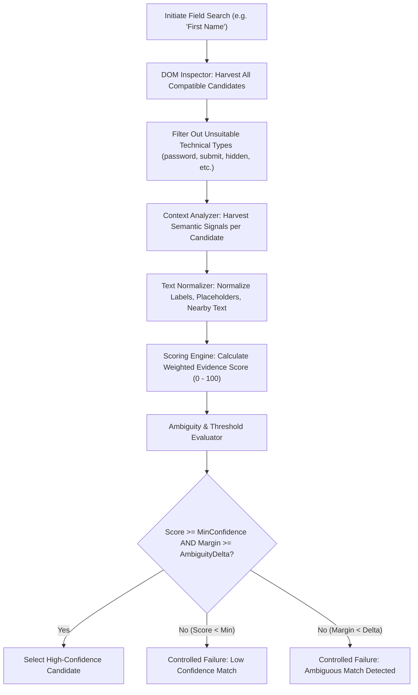

# Adaptive Element Identification Engine — Technical Specification

## 1. Overview and Problem Statement

Web applications undergo continuous modification:
- Front-end frameworks (e.g. React, Angular, Vue, Blazor) generate dynamic IDs (e.g., `id=":r1:"`, `id="input-184920"`).
- CSS redesigns modify class names, nesting structures, and element ordering.
- A/B testing platforms inject new banner elements or change container hierarchies.

Conventional test scripts fail under these conditions because they rely on brittle, hardcoded assumptions (such as `#fname` or `/html/body/div[1]/form/div[2]/input`).

The **Adaptive Element Identification Engine** replaces hardcoded selectors with deterministic runtime DOM inspection, semantic candidate extraction, normalized natural language comparison, multi-signal evidence scoring, and ambiguity safety gates.

---

## 2. Core Identification Pipeline



---

## 3. Dynamic DOM Inspection & Context Harvesting

For each candidate element on the active page, the engine gathers a multi-attribute profile (`ElementCandidate`):

1. **Direct Label (`for` association):**
   - Finds any `<label for="{id}">` pointing directly to this element.
   - Extracts trimmed, normalized text.
2. **Wrapping Label:**
   - Detects if the candidate input is wrapped by an ancestor `<label>`.
3. **Accessible Name & ARIA Signals:**
   - Inspects `aria-label`.
   - Inspects `aria-labelledby` by resolving target element IDs.
   - Inspects `title` attribute.
4. **Placeholder Text:**
   - Extracts the `placeholder` attribute (e.g. `"Name"`, `"Surname"`, `"Enter your first name"`).
5. **Structural & Container Context:**
   - Traverses up to the immediate semantic parent container (e.g. `.form-group`, `.field-row`, `<fieldset>`).
   - Extracts nearby `<label>`, `<legend>`, `<h1-h6>`, or `<span>` headings within the container.
6. **Preceding Sibling Proximity:**
   - Inspects preceding textual siblings or spans (e.g. `<span class="control-label">Male</span>`).
7. **Semantic Technical Type:**
   - Verifies element tag name (`input`, `select`, `textarea`).
   - Validates `type` attribute (`text`, `radio`, etc.).
8. **Interactive Eligibility:**
   - Ensures `Displayed == true`.
   - Ensures `Enabled == true`.
   - Checks `GetAttribute("readonly")` or `aria-disabled`.

---

## 4. Text Normalization Algorithm

Natural language field representations differ across websites:
- `"First Name"`, `"First_Name"`, `"first-name"`, `"  First   Name: "`
- Abbreviations: `"FName"`, `"Given Name"`

The `TextNormalizer` applies deterministic transformations:
1. **Trim & Whitespace Collapsing:** Multiple whitespace, tabs, and newlines become single spaces.
2. **Punctuation Stripping:** Colons, asterisks (required field indicators `*`), hyphens, underscores, and brackets are stripped or normalized to spaces.
3. **Case-Folding:** Full conversion to lowercase invariant culture (`ToLowerInvariant()`).
4. **Semantic Synonym Mapping:**
   - First Name synonyms: `"first name"`, `"firstname"`, `"given name"`, `"forename"`, `"your first name"`
   - Gender synonyms: `"gender"`, `"sex"`, `"select gender"`, `"your gender"`
   - State synonyms: `"state"`, `"select state"`, `"choose state"`, `"state/province"`, `"province"`, `"region"`

---

## 5. Multi-Signal Scoring System

Each candidate receives an auditable score evaluated against weighted heuristics:

| Signal Identifier | Weight | Description |
|---|---|---|
| `ExactAssociatedLabelMatch` | **35** | Directly associated `<label for="...">` matching a field synonym. |
| `ExactAccessibleNameMatch` | **30** | `aria-label`, `aria-labelledby`, or accessible name match. |
| `StrongContextualTextMatch`| **25** | Enclosing container label, legend, or preceding sibling match. |
| `PlaceholderMatch` | **20** | `placeholder` attribute matching field semantic concept. |
| `TechnicalTypeMatch` | **15** | Control matches expected element tag and input type. |
| `ContainerRelevance` | **10** | Surrounding form container contains related keyword context. |
| `ContradictoryPenalty` | **-50** | Element contains conflicting semantic keywords (e.g., contains `"last"`, `"sur"`, `"middle"`, `"company"` when searching for `"first name"`). |

### Mathematical Formulation
$$\text{Score}(c) = \min\left(100, \max\left(0, \sum_{i} W_i \cdot M_i(c) - \sum_{j} P_j \cdot C_j(c)\right)\right)$$
Where $W_i$ is the weight of positive signal $i$, $M_i(c) \in \{0, 1\}$ indicates signal match, $P_j$ is penalty weight, and $C_j(c)$ indicates contradictory signal match.

---

## 6. Confidence Evaluation & Ambiguity Resolution

The engine does not simply pick the highest score blindly. It classifies matches into confidence bands:

- **High Confidence (80–100):** Strong multi-signal corroboration. Safe for direct interaction.
- **Medium Confidence (60–79):** Moderate corroboration (e.g. placeholder and container match without explicit label). Requires diagnostic logging.
- **Low Confidence (< 60):** Insufficient evidence. The engine safely aborts rather than interacting with an arbitrary control.

### Ambiguity Margin Detection
If candidate $C_1$ has score $S_1$ and candidate $C_2$ has score $S_2$ such that:
$$|S_1 - S_2| < \text{AmbiguityMargin} \quad (\text{Default } \Delta = 5)$$
and both $S_1, S_2 \ge \text{MinimumConfidenceScore}$, the framework reports **Ambiguity**:
```json
{
  "status": "Ambiguous",
  "reason": "Found 2 competing candidates within margin of 5 points: Input#first_name_1 (Score: 90) vs Input#first_name_2 (Score: 90)"
}
```
**Safety Guarantee:** The framework guarantees that it will never guess between indistinguishable fields. A controlled test failure with diagnostic telemetry is strictly preferred over corrupting application state.

---

## 7. Field-Specific Discovery Strategies

### 7.1 First Name (Text Field)
- **Candidate Pool:** All visible, enabled inputs excluding `password`, `email`, `number`, `hidden`, `submit`, `button`, `radio`, `checkbox`.
- **Negative Penalties:** Candidates matching `"last"`, `"surname"`, `"middle"`, `"username"`, `"company"`, `"organization"`, `"address"` receive a -50 penalty.
- **Selection Assertion:** Value written is re-queried via `.GetAttribute("value")` and compared with the input string.

### 7.2 Gender (Radio Button Group)
- **Grouping Heuristic:**
  1. Primary: Shared `name` attribute among `input[type='radio']`.
  2. Fallback: Shared parent container (`fieldset`, `.form-group`, or common ancestor) enclosing a label matching `"gender"`.
- **Option Selection:**
  - Matches the configured target option (e.g. `"Male"`) against:
    - Input `value` attribute (`value="Male"`).
    - Adjacent `<label>` or `<span>` sibling text.
    - Child label text.
- **Verification:** Selected radio is verified via `.Selected == true`.

### 7.3 State (Dropdown / Select)
- **Candidate Pool:** All `<select>` elements on the page.
- **Differentiating from Country / City:**
  - Scores the `<select>` associated label against `"state"`, `"province"`, `"region"`.
  - Distinguishes standard `<select>` from autocomplete `<input>` controls.
- **Option Selection:**
  - Wraps in Selenium `SelectElement`.
  - Discovers option by exact or normalized visible text (e.g. `"India"` matching `" India "`).
- **Verification:** Selected option is verified via `select.SelectedOption.Text`.

