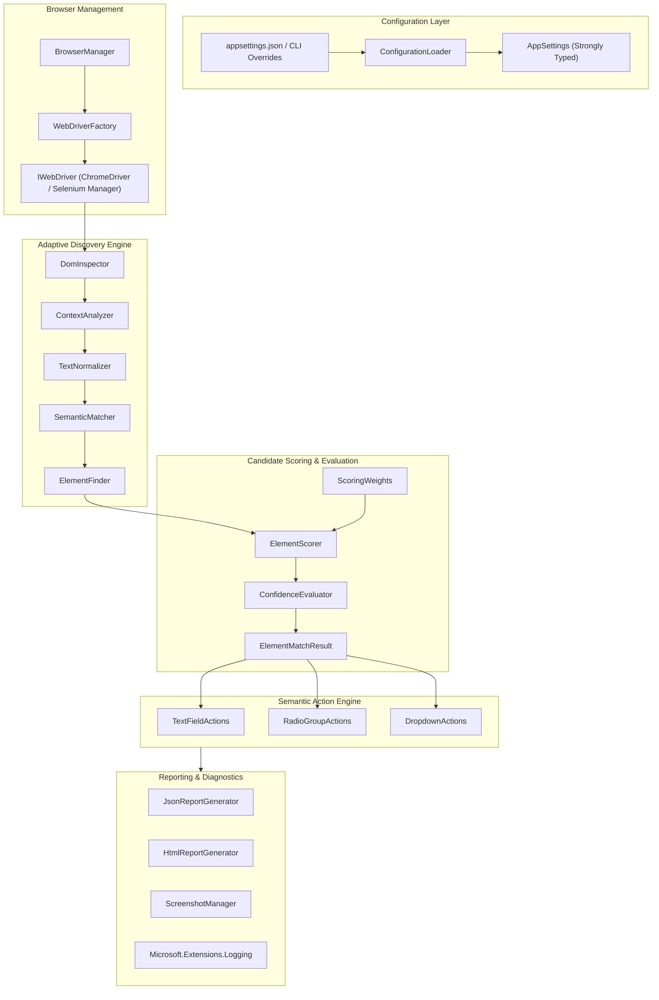
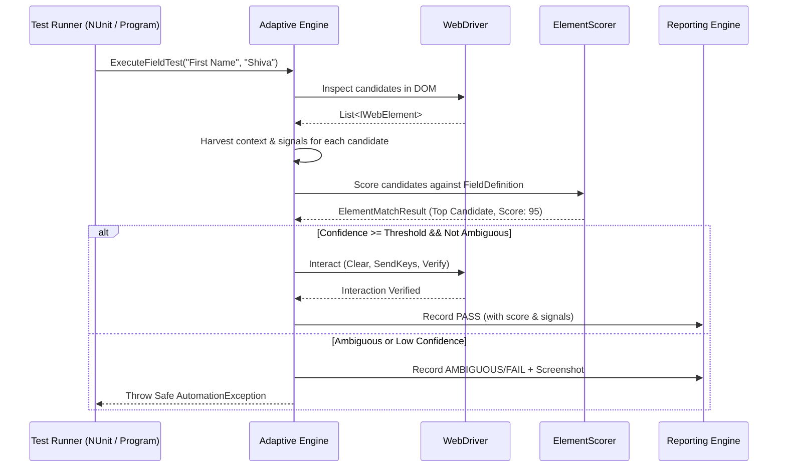

# Architecture Document — Adaptive Selenium Automation Framework

## 1. Architectural Philosophy

Conventional Selenium test suites rely heavily on brittle locator strategies:
- Fixed IDs (`#fname`, `#state`)
- Static name attributes (`name="gender"`)
- Brittle CSS class hierarchies (`div.col-xs-6 > input.form-control`)
- Positional XPaths (`//form/div[1]/div[2]/input`)

When a website updates—refactoring layouts, adopting dynamic ID generators (React, Angular, Blazor), or changing styling classes—conventional test automation breaks immediately despite the underlying business functionality remaining unchanged.

This framework introduces an **Adaptive Semantic Identification Engine**. Instead of expecting static locators, it inspects the live DOM at runtime, extracts multi-dimensional semantic signals, normalizes textual semantics, scores candidate elements against field definitions, and determines the best element using calibrated confidence thresholds and ambiguity safeguards.

---

## 2. System Architecture Diagram

---

## 3. Core Component Breakdown

### 3.1 Configuration Layer
- **`AppSettings`**: Strongly typed C# records mapping to `appsettings.json`, including browser configuration, base URL, test data values, matching weights, confidence thresholds, and timeouts.
- **`ConfigurationLoader`**: Merges default configuration from `appsettings.json`, environment variables (`AUTOMATION_*`), and command-line arguments (e.g. `--url <url>`, `--headless <bool>`).

### 3.2 Browser Layer
- **`WebDriverFactory`**: Initializes Chrome (and Edge) with recommended headless and options flags (`--no-sandbox`, `--disable-dev-shm-usage`, window sizing). Uses Selenium 4's built-in Selenium Manager for automated driver acquisition.
- **`BrowserManager`**: Lifecycle management with deterministic disposal (`IDisposable`), clean session resets, and screenshot capture on failure triggers.

### 3.3 Models Layer
- **`FieldDefinition`**: Declares target field metadata:
  - `FieldName` (e.g. `"First Name"`)
  - `FieldType` (`TextInput`, `RadioGroup`, `Dropdown`)
  - `SemanticSynonyms` (e.g., `["First Name", "Firstname", "Given Name"]`)
  - `NegativeKeywords` (e.g., `["Last", "Surname", "Middle", "User", "Company"]`)
  - `ExpectedValue`
- **`ElementCandidate`**: Encapsulates an inspected DOM element with harvested signals:
  - Element reference (`IWebElement`)
  - Tag name and input type
  - Direct label association (`<label for="...">`)
  - Enclosing label text
  - Nearby contextual text (siblings, parent container headers, legends)
  - `id`, `name`, `placeholder`, `aria-label`, `aria-labelledby`, `title`
  - Current value and options (for select elements)
  - Visibility and enabled state
- **`ElementMatchResult`**: Matching outcome containing:
  - Selected candidate
  - Score (0–100)
  - Confidence Level (`High`, `Medium`, `Low`, `Rejected`)
  - Scoring breakdown (evidence details)
  - Ambiguity status (`IsAmbiguous`, delta score)
  - Diagnostic reason and rejected candidates
- **`TestResult`**: Structured test execution record.

### 3.4 Discovery & Semantic Analysis Layer
- **`TextNormalizer`**: Handles punctuation stripping, tokenization, case-folding, whitespace collapsing, and common abbreviation expansion.
- **`DomInspector`**: Discovers candidate DOM elements through generalized, non-brittle queries:
  - For Text: `input:not([type='hidden']):not([type='submit']):not([type='button']):not([type='radio']):not([type='checkbox']):not([type='file'])`
  - For Radio: `input[type='radio']`
  - For Dropdown: `select`
- **`ContextAnalyzer`**: Traverses DOM relationships to extract semantic labels:
  - Direct `for` attribute matching
  - Container-level labels (`div.form-group label`, `fieldset legend`)
  - Proximity text (preceding siblings, preceding text nodes)
  - ARIA references (`aria-labelledby`)
- **`SemanticMatcher`**: Calculates text similarity between field synonyms and candidate signals using exact token matching, prefix matching, and substring penalties.

### 3.5 Scoring & Confidence Evaluation Layer
- **`ScoringWeights`**: Configurable signal weights:
  - Exact Associated Label Match: 35
  - Accessible Name / ARIA Match: 30
  - Strong Contextual Text Match: 25
  - Placeholder Match: 20
  - Matching Technical Input Type: 15
  - Container/Group Proximity: 10
  - Conflicting Negative Keyword: -50 penalty
- **`ElementScorer`**: Calculates candidate scores and generates an auditable score breakdown.
- **`ConfidenceEvaluator`**: Evaluates top candidate against `MinimumConfidenceScore` (default 80) and checks `AmbiguityMargin` against runner-up candidates.

### 3.6 Semantic Action Engine
- **`TextFieldActions`**: Robust interaction for text inputs:
  - Explicit wait for element interactability.
  - Value clearing (backspace/clear).
  - Keystroke entry.
  - Post-interaction assertion on `value` attribute.
- **`RadioGroupActions`**: Logical grouping and option selection:
  - Groups radio candidates by semantic context or `name`.
  - Locates matching option by value, adjacent span/label text.
  - Safe click with JavaScript click fallback for custom-styled radio buttons.
  - Post-selection assertion on `Selected` state.
- **`DropdownActions`**: Robust interaction with standard HTML `<select>` elements:
  - Wraps in Selenium `SelectElement`.
  - Matches target option by normalized visible text or `value`.
  - Verification of `SelectedOption`.

### 3.7 Reporting & Diagnostic Layer
- **`JsonReportGenerator`**: Produces machine-readable JSON reports detailing candidate scores, confidence levels, matching strategies, execution durations, and test outcomes.
- **`HtmlReportGenerator`**: Generates a visually rich HTML dashboard with passing status badges, score breakdowns, and failure screenshots.
- **`ScreenshotManager`**: Automatically captures full-browser or viewport screenshots upon failures or ambiguity rejections.

---

## 4. Execution Lifecycle

